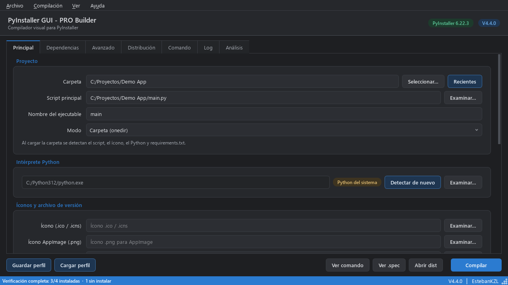
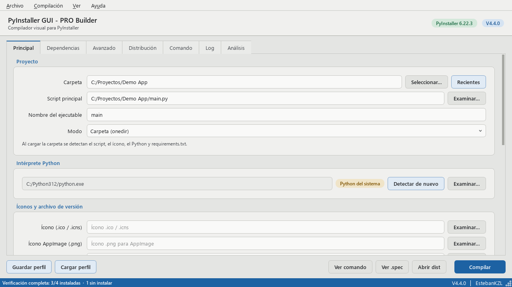
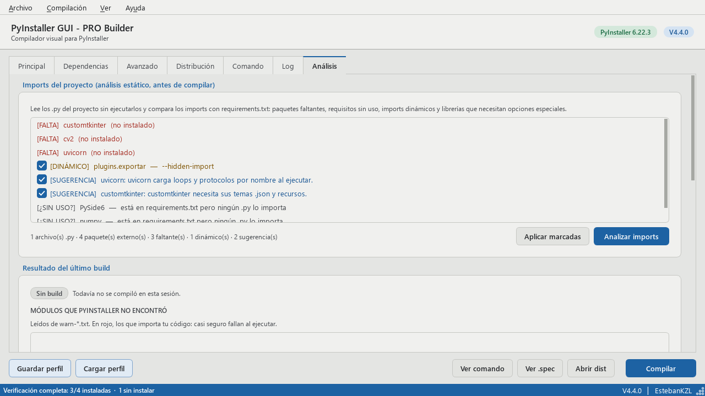
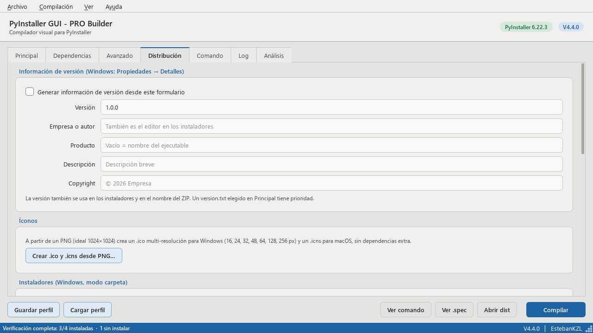
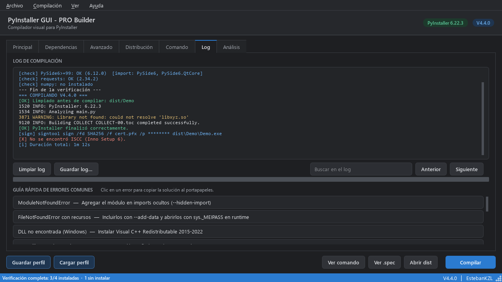

# PyInstaller GUI - PRO Builder

Compilador visual para [PyInstaller](https://pyinstaller.org) y [Nuitka](https://nuitka.net): elegís la
carpeta de tu proyecto en Python y la herramienta detecta el script, el intérprete y las dependencias, arma
el comando, compila, analiza el resultado y genera instaladores listos para distribuir.

[](https://github.com/EstebanKZL/PyInstaller_GUI/actions/workflows/ci.yml)
[](https://github.com/EstebanKZL/PyInstaller_GUI/releases/latest)
[](LICENSE)

| Grafito (oscuro) | Papel (claro) |
|---|---|
|  |  |

## Descargas

Bajá la última versión desde **[Releases](https://github.com/EstebanKZL/PyInstaller_GUI/releases/latest)**:

| Sistema | Arquitectura | Archivo |
|---|---|---|
| Windows 10 / 11 | 64 bits | `PyInstallerGUI-<versión>-win-x64-setup.exe` / `-win-x64-portable.zip` |
| Windows 7 / 8 | 64 bits | `PyInstallerGUI-<versión>-win7-x64-setup.exe` / `-win7-x64-portable.zip` |
| Windows 7 / 8 / 10 / 11 | 32 bits | `PyInstallerGUI-<versión>-win7-x86-setup.exe` / `-win7-x86-portable.zip` |
| Linux | x86_64 | `PyInstallerGUI-<versión>-linux-x86_64.AppImage` |

`setup` es el instalador (Inno Setup) y `portable` se descomprime y se ejecuta sin instalar. Verificá la
descarga con `SHA256SUMS.txt`.

Qt 6 no existe para 32 bits ni para Windows 7, así que esos paquetes usan Python 3.8 y Qt 5 (PySide2).
PyInstaller soporta oficialmente desde Windows 8: en Windows 7 (SP1 con KB2533623 y KB2999226) funciona,
pero no está garantizado. Los ejecutables no están firmados, así que Windows SmartScreen puede pedir
confirmación.

## Funciones

**Proyecto y compilación**
- **Dos compiladores:** PyInstaller (rápido, empaqueta el intérprete) o **Nuitka** (traduce a C y compila
  un binario nativo, sin código legible). Las mismas opciones sirven para los dos.
- Detección automática del script principal, el ícono y el intérprete Python (venv del proyecto, PATH,
  `py.exe`, registro de Windows).
- Todas las opciones de PyInstaller: onedir/onefile, consola, UPX, strip, bytecode optimizado,
  `--uac-admin`, `--runtime-tmpdir`, `--add-data`, imports ocultos, módulos excluidos, `--collect-all`,
  `--collect-data`, `--copy-metadata` y flags adicionales.
- Comando y `.spec` equivalentes siempre sincronizados, listos para copiar o guardar.
- **Entorno aislado:** compila en un venv limpio creado desde `requirements.txt`, para un ejecutable más
  chico y reproducible.
- Limpieza segura: solo borra la salida anterior de la app, nunca carpetas completas.
- Cancelación real: se detiene PyInstaller junto con todos sus subprocesos.

**Dependencias y análisis**
- Escaneo de `requirements.txt`: qué está instalado, con qué versión y con qué nombre se importa
  (Pillow → `PIL`, opencv-python → `cv2`), e instalación con pip desde la interfaz.
- **Análisis estático de imports** (sin ejecutar tu código): paquetes que faltan en `requirements.txt`,
  requisitos sin uso, imports dinámicos que PyInstaller no ve y librerías que necesitan opciones especiales.
- **Después de cada build:** módulos que PyInstaller no encontró, tamaño por paquete, diagnóstico del log
  con soluciones aplicables en un clic, y prueba del ejecutable generado.

**Distribución**
- Información de versión de Windows desde un formulario.
- `.ico` multi-resolución y `.icns` a partir de un PNG, sin dependencias extra.
- Instaladores **Inno Setup** y **NSIS** (Windows) y **AppImage** (Linux).
- Firma de código con `signtool` (Windows) o `codesign` (macOS). La contraseña del certificado nunca se
  guarda: se lee de una variable de entorno.
- ZIP portable y `SHA256SUMS.txt`, con nombres `<App>-<versión>-<sistema>-<arq>-<variante>`
  (`MiApp-1.0.0-win-x64-setup.exe`, `MiApp-1.0.0-linux-x86_64.AppImage`).
- Generador de **workflow de GitHub Actions** para compilar tu app en Windows, Linux y macOS a la vez.

**Interfaz**
- Temas Grafito (oscuro) y Papel (claro), en español e inglés (*Ver → Cambiar tema* / *Ver → Idioma*).
- Ayuda contextual en cada control, log coloreado con búsqueda, atajos de teclado y aviso al terminar.
- Perfiles JSON para guardar y reutilizar la configuración de cada proyecto.

| Análisis | Distribución | Log |
|---|---|---|
|  |  |  |

## Ejecutar desde el código

Requiere Python 3.8 o superior. Con Python 3.10+ se instala PySide6; con 3.8 o 3.9, PySide2.

```bash
git clone https://github.com/EstebanKZL/PyInstaller_GUI.git
cd PyInstaller_GUI
python -m pip install -r requirements.txt pyinstaller
python PyInstaller_GUI.py
```

## Modo línea de comandos

Con un perfil guardado desde la interfaz se puede compilar sin abrir la ventana, por ejemplo en un
servidor o en CI. Este modo no necesita PySide instalado.

```bash
python PyInstaller_GUI.py --profile mi_app_profile.json            # muestra el comando
python PyInstaller_GUI.py --profile mi_app_profile.json --build    # compila
python PyInstaller_GUI.py --profile mi_app_profile.json --build --isolated
python PyInstaller_GUI.py --help
```

## Desarrollo

```bash
python -m pip install -r requirements.txt pytest ruff pyinstaller pyyaml
python -m ruff check .
python -m pytest -q -m "not slow"     # tests rápidos
python -m pytest -q                   # incluye builds reales con PyInstaller
```

El código está en el paquete `pyinstaller_gui/`:

| Ruta | Contenido |
|---|---|
| `core/` | Núcleo sin Qt: configuración (`BuildConfig`), comando y `.spec`, build, análisis, instaladores, firma, release |
| `ui/` | Interfaz: ventana principal, pestañas, tema y componentes |
| `i18n.py` | Textos en español e inglés |
| `cli.py` | Modo línea de comandos |
| `release/` | Script y notas de los paquetes de release |

La integración continua prueba cada cambio en Windows, Linux y macOS con Python 3.8, 3.10 y 3.13.
Las releases se publican al subir un tag `v*` (ver `.github/workflows/release.yml`).

Los cambios de cada versión están en el [CHANGELOG](CHANGELOG.md).

## Licencia

[MIT](LICENSE) © 2026 EstebanKZL
